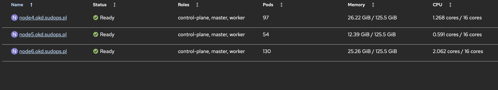
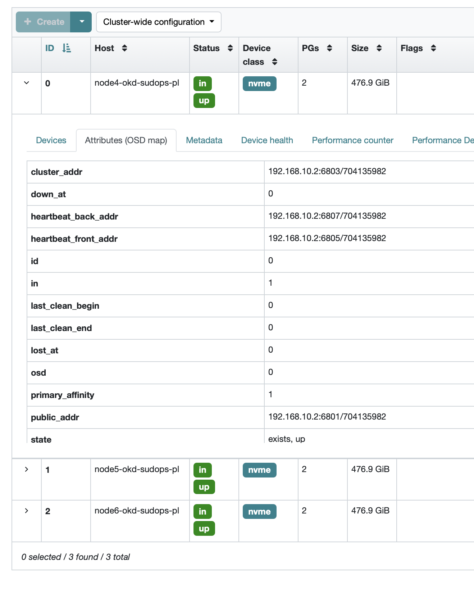
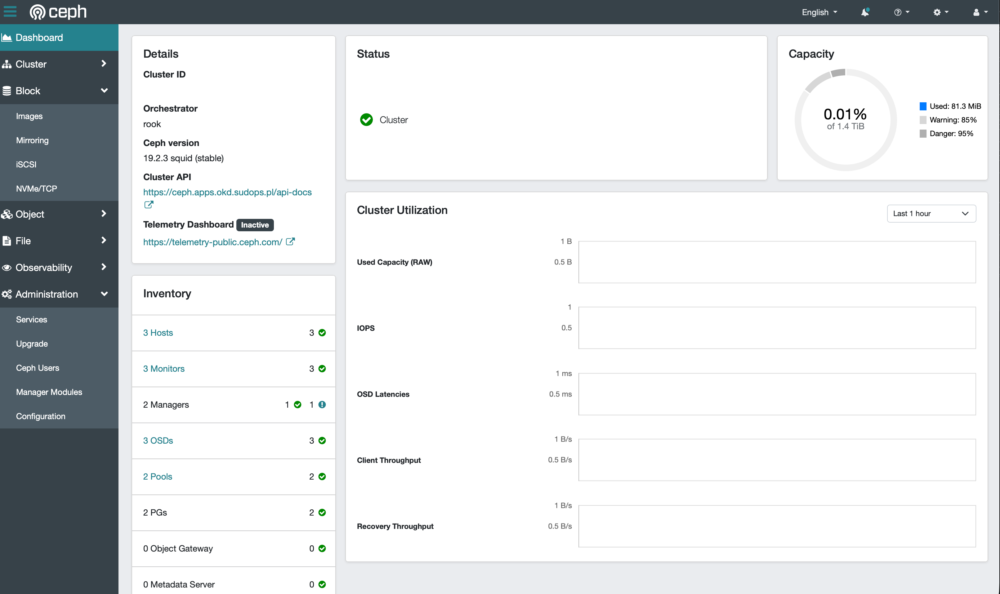

[ArgoCD](/blog/homelab-day2/bootstrap) deploys, [cert-manager](/blog/homelab-day2/cert-manager) handles TLS, and the [storage network](/blog/homelab-day2/storage-network) gives every node a 10GbE path on VLAN 10. The last piece of Day 2 is storage: a replicated block pool on the NVMe drives, so Prometheus, Grafana and everything after them have somewhere to put data.

This post is the build, including the first thing that broke. Rook-Ceph on three nodes that are also the control plane has no spare capacity to hide mistakes in.

:::note[Versions]
I built this on Rook v1.19.3 with Ceph Squid 19.2.3, and the config blocks below are from that build. The cluster now runs Rook v1.21.1 and Ceph Tentacle 20.2.5. [Where it ended up](#rook-ceph-where-it-ended-up) says what changed. The upgrade has its own post, coming soon.
:::

## Hardware, and why Rook-Ceph

Three identical nodes, each control plane and worker at once. The OKD console shows 16 cores and about 125 GiB of RAM per node. Each has one NVMe drive for Ceph (500 GB PNY CS1030 consumer drives at the time, since swapped for Samsung PM9A1; 476.9 GiB each as Ceph sees them) and an OS disk on a different bus. Replication runs over the storage network from the previous post:

| Node | Frontend IP (1G) | Storage IP (10G, VLAN 10) |
|---|---|---|
| node4.okd.sudops.pl | 192.168.1.7 | 192.168.10.2 |
| node5.okd.sudops.pl | 192.168.1.8 | 192.168.10.3 |
| node6.okd.sudops.pl | 192.168.1.9 | 192.168.10.4 |



Why Rook-Ceph, and not something simpler? The first consumers are Prometheus, Alertmanager and Grafana, which want replicated volumes with decent write latency.

- **Local-path provisioner.** No replication. A dead node means lost data.
- **NFS from the Synology.** Wrong for a Prometheus TSDB or SQLite. Write latency matters there.
- **OpenShift Data Foundation.** Needs a subscription and a minimum of three dedicated storage nodes. Too much for a homelab.

Rook-Ceph gives me three-way replicated block storage on drives I already own, with no licence.

## Sync-wave layout

Everything goes through ArgoCD with the [app-of-apps pattern](/blog/homelab-day2/bootstrap) and sync waves. The order that matters:

```
Wave 0  →  Node labels (failure domains), kubelet config
Wave 1  →  Rook-Ceph operator
Wave 3  →  CephCluster, toolbox, block pool, StorageClass, dashboard Route
Wave 5  →  Prometheus, Alertmanager, Grafana (PVCs on Ceph)
```

The operator has to be running before a CephCluster can exist, and the StorageClass has to exist before anything asks for a PVC. In the build I describe here, the pool and StorageClass were their own app one wave later. They live in the cluster chart now.

## The operator, and OpenShift's SCCs

The operator is the official `rook-ceph` Helm chart as a subchart. Three values on top of the defaults:

```yaml
# components/operators/rook-ceph/values.yaml
rook-ceph:
  # OpenShift requires privileged hostPath access
  hostpathRequiresPrivileged: true
  # Enable host networking for Ceph daemons (adds allowHostNetwork to SCC)
  useOperatorHostNetwork: true
  monitoring:
    enabled: true
```

Two values are for OpenShift, one turns on metrics. The namespace gets privileged pod-security labels, plus one that is easy to miss:

```yaml
# components/operators/rook-ceph/templates/namespace.yaml
metadata:
  name: rook-ceph
  labels:
    pod-security.kubernetes.io/enforce: privileged
    pod-security.kubernetes.io/audit: privileged
    pod-security.kubernetes.io/warn: privileged
    openshift.io/cluster-monitoring: "true"
```

`openshift.io/cluster-monitoring: "true"` is what makes OpenShift's Prometheus scrape ServiceMonitors in the namespace. Without it, the Ceph metrics go nowhere.

### Pod security labels are not enough

The labels let pods *ask* for privileged contexts. On OpenShift each ServiceAccount also needs RBAC access to a SecurityContextConstraint. The Rook chart ships its own `rook-ceph` SCC and binds it to the accounts it manages: the operator, OSDs, mgr and so on.

It misses two. The `default` account in `rook-ceph` (the CSI plugin pods Rook creates use it) and `rook-ceph-tools`, the toolbox, which runs on host networking. They need a binding of their own:

```yaml
# components/operators/rook-ceph/templates/scc-rbac.yaml
apiVersion: rbac.authorization.k8s.io/v1
kind: ClusterRole
metadata:
  name: rook-ceph-scc-extra
rules:
  - apiGroups: ["security.openshift.io"]
    resources: ["securitycontextconstraints"]
    resourceNames: ["rook-ceph"]
    verbs: ["use"]
---
apiVersion: rbac.authorization.k8s.io/v1
kind: ClusterRoleBinding
metadata:
  name: rook-ceph-scc-extra
roleRef:
  apiGroup: rbac.authorization.k8s.io
  kind: ClusterRole
  name: rook-ceph-scc-extra
subjects:
  - kind: ServiceAccount
    name: default
    namespace: rook-ceph
  - kind: ServiceAccount
    name: rook-ceph-tools
    namespace: rook-ceph
```

Without it the toolbox sits in `CreateContainerConfigError` and the CSI plugin pods fail with `unable to validate against any security context constraint`. The toolbox error doesn't mention SCC at all, which is why it cost me time. My first attempts at this were custom SCCs of my own. Deleting them and using the ones the chart ships was the fix.

## The CephCluster on the 10G backnet

The CephCluster CR is where the decisions live. My plan was simple: Ceph daemons on host networking, bound to the 10G storage VLAN, so client traffic and replication both get the fast link. The nodes' primary IP is on the 1G frontend, and Rook's `network.addressRanges` pins Ceph to a different subnet:

```yaml
network:
  provider: host
  addressRanges:
    public:
      - "192.168.10.0/24"   # 10G storage backnet
    cluster:
      - "192.168.10.0/24"
```

(This chart was later replaced by upstream's `rook-ceph-cluster` wrapper. More on that at the end.)

Host networking means a Ceph daemon binds to a node IP instead of getting a pod IP. No CNI in the data path, and I can choose the interface. The cluster came up healthy, three mons and three OSDs. The dashboard showed the OSD addresses I wanted:



It looked right, and it was wrong in a way I only found when the first PVC appeared.

### The trap: CSI clients live on the SDN

Creating a PVC makes the `csi-rbdplugin` controller pod call `CreateVolume`. That pod is a regular pod on the OVN software-defined network (`hostNetwork: false`). To create an RBD image it asks the mons for the OSD map, then connects to the OSDs at the addresses in that map.

The OSDs bind on `public_network`, which I had set to `192.168.10.0/24`. A pod on the SDN has no route to that subnet. It reaches the mons, because those happened to advertise on `192.168.1.x`, and then hangs forever trying to reach an OSD.

<!-- DIAGRAM: day2-ceph-csi-trap.png (ASCII sketch, redraw in Excalidraw; three panels stacked, BEFORE / FIRST FIX / NOW)

  BEFORE (the trap)
  ┌─ OVN SDN (pod network) ───────────────────────────────────────────────────┐
  │  [CSI controller pod]                                                     │
  └───┬───────────────────────────────┬───────────────────────────────────────┘
      │ ok                            │ ✗ no route to 192.168.10.0/24
  ┌───▼─ node4 / node5 / node6 ───────┴───────────────────────────────────────┐
  │ 1G  192.168.1.0/24 (grey)   [mon a/b/c] (advertised here)                 │
  │ 10G 192.168.10.0/24 VLAN 10 (thick teal)                                  │
  │     [osd.0] [osd.1] [osd.2]    [toolbox, hostNetwork] ══► OSDs  ok        │
  └───────────────────────────────────────────────────────────────────────────┘

  FIRST FIX
  ┌─ OVN SDN (pod network) ───────────────────────────────────────────────────┐
  │  [CSI controller pod]                                                     │
  └───┬───────────────────────────────────────────────────────────────────────┘
      │ ok, capped ~118 MB/s (1G)
  ┌───▼─ node4 / node5 / node6 ───────────────────────────────────────────────┐
  │ 1G  192.168.1.0/24 (grey)   [mon a/b/c]   [OSD public side]               │
  │ 10G 192.168.10.0/24 VLAN 10 (thick teal)                                  │
  │     [osd.0] ══ [osd.1] ══ [osd.2]   cluster network (replication), 10G    │
  └───────────────────────────────────────────────────────────────────────────┘

  NOW
  ┌─ node4 / node5 / node6 ───────────────────────────────────────────────────┐
  │ 1G  192.168.1.0/24 (grey)   [mon a/b/c]  ──► clients (thin, "map only")   │
  │                                                                           │
  │ [CSI controller pod]  hostNetwork: true, pod IP = node IP                 │
  │        ║ green                                                            │
  │        ▼                                                                  │
  │ 10G 192.168.10.0/24 VLAN 10 (thick teal) ═════════════════════════════════│
  │     [osd.0] [osd.1] [osd.2]   OSD public + cluster on the same lane       │
  └───────────────────────────────────────────────────────────────────────────┘
  Corner caption: "no Multus, no second NIC"

  Colours: ok = green arrow, ✗ = red X, 10G = thick teal, 1G = grey.
-->

What I saw was this:

```
ProvisioningFailed  rpc error: code = DeadlineExceeded desc = context deadline exceeded
ProvisioningFailed  rpc error: code = Aborted desc = an operation with the given Volume ID ... already exists
```

The second message sent me the wrong way. It looks like a CSI bug. It is the plugin's in-memory tracking saying "the previous `CreateVolume` for this ID is still running, I won't start another one". The first call never finished because TCP to `192.168.10.4:6800` timed out. I restarted CSI pods for a while, which is the documented answer to that error, before I understood the problem was below the CSI layer.

### Diagnosing it

Two commands made it obvious. The same operation, once from the toolbox and once from a CSI pod:

```bash
# From the toolbox pod (hostNetwork: true, so it has the 10G interface)
oc -n rook-ceph exec deploy/rook-ceph-tools -- rbd ls -p nvme-replicated
# returns instantly

# From the CSI plugin pod (SDN only)
oc -n rook-ceph exec rook-ceph.rbd.csi.ceph.com-ctrlplugin-... -c csi-rbdplugin -- \
  rbd ls -p nvme-replicated -m <mons> --id csi-rbd-provisioner.1 --key=<key> --debug-ms 1
# hangs, with:
#   conn(... v2:192.168.10.4:6800 ...) tick see no progress in more than 10000000 us
```

The toolbox is on the host network and reaches everything. The CSI pod reaches the mons and nothing else. `--debug-ms 1` was the most useful flag in this whole exercise: it prints the exact `v2:IP:PORT` the client is stuck on, and the IP was a `192.168.10.x` address the pod had no route to.

### The first fix: public network on the 1G front

The OSDs are reachable from the SDN if their public side is on a subnet the SDN can reach. That's the frontend:

```yaml
network:
  provider: host
  addressRanges:
    public:
      - "192.168.1.0/24"   # SDN-reachable, but only 1G
    cluster:
      - "192.168.10.0/24"  # OSD-to-OSD replication stays on 10G
```

Rook updates the Ceph config when you commit this, but it does **not** roll the daemons. The mons already advertised on `192.168.1.x`, so they were fine. The OSDs kept their old bind addresses until I restarted them, one at a time, waiting for `HEALTH_OK` in between:

```bash
for i in 0 1 2; do
  oc -n rook-ceph delete pod -l app=rook-ceph-osd,osd=$i
  until oc -n rook-ceph exec deploy/rook-ceph-tools -- ceph -s | grep -q HEALTH_OK; do sleep 5; done
done
```

After that `ceph osd metadata` showed the new front address:

```
"front_addr": "[v2:192.168.1.7:6800/...,v1:192.168.1.7:6801/...]"
```

PVC bound, pod mounted, life was good. On paper, every client write now crosses a 1G NIC, which tops out around 118 MB/s. Replication stays on the 10G backnet, so recovery isn't affected.

I'm keeping this stage on purpose. It is the cluster as it ran for a while, and a later post in the Storage series benchmarks it properly. I'm not going to claim here how much the 1G link actually cost, because I measured that later and the answer wasn't what I expected.

:::note[Why not fix it properly right away?]
The textbook answer is Multus: give the CSI pods a second NIC on the storage network and move `public_network` back to the backnet. That is a real migration, with its own pitfalls, and I tried it. For now the point is the diagnosis: ask "who talks to the OSDs?" before picking the public subnet.
:::

## Failure domains, device names and resources

### Failure domains

Each node gets a topology label from a small chart in wave 0:

```yaml
# components/cluster-config/node-labels/values.yaml
nodes:
  - hostname: node4.okd.sudops.pl
    labels:
      topology.kubernetes.io/zone: fd-a
  - hostname: node5.okd.sudops.pl
    labels:
      topology.kubernetes.io/zone: fd-b
  - hostname: node6.okd.sudops.pl
    labels:
      topology.kubernetes.io/zone: fd-c
```

The pool uses `failureDomain: host`, with `size: 3` and `min_size: 2`. Ceph puts one replica on each node. With one node per zone, host and zone are the same thing here. One node can go down and the pool stays up in degraded mode, which is the point of the whole design.

### Positional device names

One OSD per node, and I named the device by its slot:

```yaml
# components/storage/rook-ceph-cluster/values.yaml
storage:
  useAllNodes: false
  useAllDevices: false
  nodes:
    - name: "node4.okd.sudops.pl"
      devices:
        - name: "/dev/nvme0n1"
    - name: "node5.okd.sudops.pl"
      devices:
        - name: "/dev/nvme0n1"
    - name: "node6.okd.sudops.pl"
      devices:
        - name: "/dev/nvme0n1"
```

I started with `/dev/disk/by-id/nvme-...`, which is the usual advice. It is keyed off the drive's serial, so it survives `nvme0` and `nvme1` swapping at boot. It also names one physical drive, so it changes the moment I replace that drive, and then values.yaml needs an edit.

Here every node has exactly one NVMe slot, and the OS lives on a different bus. So `/dev/nvme0n1` is always the right device. A replacement needs no change in Git. If a node ever gets two NVMe drives, the assumption breaks and I go back to by-id. For now positional is the smaller blast radius.

### Resources for small nodes

Three nodes with everything on them, so Ceph can't take whatever it likes:

```yaml
# components/storage/rook-ceph-cluster/values.yaml
resources:
  mon:
    requests: { cpu: "500m", memory: "1Gi" }
    limits: { memory: "2Gi" }
  mgr:
    requests: { cpu: "500m", memory: "512Mi" }
    limits: { memory: "1Gi" }
  osd:
    requests: { cpu: "1", memory: "5Gi" }
    limits: { memory: "6Gi" }
```

I also set `osd_memory_target` to 4 GiB, the floor I would accept for NVMe OSDs. Lower values mean more cache eviction and latency spikes. Ceph 19 defaults to 4 GiB anyway, so that line is gone from the values now.

The part that matters more is protecting the node itself. I reserve 3 GiB for the system with a `KubeletConfig`, so pods can't take the memory the kubelet, CRI-O and OVN need:

```yaml
# components/cluster-config/kubelet-config/templates/system-reserved.yaml
apiVersion: machineconfiguration.openshift.io/v1
kind: KubeletConfig
metadata:
  name: system-reserved-increase
spec:
  machineConfigPoolSelector:
    matchLabels:
      pools.operator.machineconfiguration.openshift.io/master: ""
  kubeletConfig:
    systemReserved:
      memory: "3Gi"
```

The `master` pool covers all three nodes, because they are control plane and worker. Applying it rolls the nodes one at a time through the Machine Config Operator, about ten minutes of churn the first time.

## Storage: one NVMe pool, replica 3

One pool, one default StorageClass:

```yaml
# components/storage/rook-ceph-cluster/values.yaml
cephBlockPools:
  - name: nvme-replicated
    spec:
      failureDomain: host
      deviceClass: nvme
      replicated:
        size: 3
        requireSafeReplicaSize: true
    storageClass:
      enabled: true
      name: ceph-nvme-block
      isDefault: true
      reclaimPolicy: Delete
      allowVolumeExpansion: true
      parameters:
        imageFormat: "2"
        imageFeatures: layering
        csi.storage.k8s.io/fstype: ext4
```

`deviceClass: nvme` ties the pool to the NVMe OSDs. That matters later when other drive types join the cluster. Making `ceph-nvme-block` the default means a PVC without a `storageClassName` lands on Ceph. I picked ext4 over XFS because it is simpler to debug and resize, and for Prometheus and SQLite there is no difference I can measure. (The block above is trimmed. The real StorageClass also lists the CSI secret names.)

<!-- DIAGRAM: day2-ceph-layout.png (ASCII sketch, redraw in Excalidraw)

  ┌─ node4 (fd-a) ──────┐  ┌─ node5 (fd-b) ──────┐  ┌─ node6 (fd-c) ──────┐
  │ 192.168.10.2        │  │ 192.168.10.3        │  │ 192.168.10.4        │
  │ [mon-a]             │  │ [mon-b]             │  │ [mon-c]             │
  │ [osd.0]             │  │ [osd.1]             │  │ [osd.2]             │
  │  /dev/nvme0n1       │  │  /dev/nvme0n1       │  │  /dev/nvme0n1       │
  └────────▲────────────┘  └────────▲────────────┘  └────────▲────────────┘
  (plus 2 mgrs: active + standby, on any two nodes)
  ═════════╪════ 10G storage network, VLAN 10 (replication) ═╪═════════════
           │ replica               │ replica                 │ replica
  ┌────────┴───────────────────────┴─────────────────────────┴────────────┐
  │ CephBlockPool nvme-replicated                                         │
  │ size 3 · min_size 2 · failureDomain host · deviceClass nvme           │
  └───────────────────────────────────┬───────────────────────────────────┘
                                      │
                 ┌────────────────────┴─────────────────────┐
                 │ StorageClass ceph-nvme-block (default, ext4) │
                 └─────────┬────────────────────────┬───────┘
                           ▼                        ▼
                        [ PVC ]  ───────►  [ Pod: Prometheus, Grafana ]
-->

## Monitoring

### ServiceMonitor and RBAC

The mgr's Prometheus endpoint is scraped through a ServiceMonitor. OpenShift's Prometheus also needs permission to look inside the `rook-ceph` namespace:

```yaml
# components/storage/rook-ceph-cluster/templates/servicemonitor.yaml
apiVersion: monitoring.coreos.com/v1
kind: ServiceMonitor
metadata:
  name: rook-ceph-mgr
  namespace: rook-ceph
spec:
  namespaceSelector:
    matchNames:
      - rook-ceph
  selector:
    matchLabels:
      app: rook-ceph-mgr
      rook_cluster: rook-ceph
  endpoints:
    - port: http-metrics
      path: /metrics
      interval: 15s
```

The RBAC is a `Role` that lets the `prometheus-k8s` ServiceAccount in `openshift-monitoring` get, list and watch services, endpoints and pods in `rook-ceph`, plus a RoleBinding. Without it, Prometheus finds the ServiceMonitor and cannot resolve the targets. It ends up in the same chart, `templates/prometheus-scrape-rbac.yaml`.

### The dashboard, and a Prometheus detour

The Ceph dashboard runs on plain HTTP port 8080 inside the cluster, with TLS ended at the OpenShift router. A Route exposes it, and the wildcard certificate from the cert-manager post means no browser warning:

```yaml
# components/storage/rook-ceph-cluster/templates/dashboard-route.yaml
apiVersion: route.openshift.io/v1
kind: Route
metadata:
  name: ceph-dashboard
  namespace: rook-ceph
spec:
  host: ceph.apps.okd.sudops.pl
  to:
    kind: Service
    name: rook-ceph-mgr-dashboard
  port:
    targetPort: http-dashboard
  tls:
    termination: edge
    insecureEdgeTerminationPolicy: Redirect
```

Edge termination is the one that works. I tried passthrough with the dashboard's own self-signed certificate (a browser exception every time) and re-encrypt (more moving parts than the problem deserves), and landed on plain edge. `insecureEdgeTerminationPolicy: Redirect` quietly upgrades `http://` to `https://`.

This is the cluster as I first built it, a few minutes after the dashboard came up:



I also wanted the dashboard's built-in graphs, which need a Prometheus URL, and that went badly:

1. Prometheus on OKD listens on `127.0.0.1:9090`. Nothing else in the cluster can reach it directly.
2. The `prometheus-operated` service actually hits `kube-rbac-proxy` on port 9091, which wants a bearer token.
3. The Ceph mgr is on host networking. It can reach ClusterIPs but not pod IPs.

I built a small Python auth proxy to get around that and then deleted it. The dashboard is good for managing the cluster. Graphs belong in Grafana.

### Grafana

Three community dashboards, loaded by ID with the grafana-operator: Ceph cluster (2842), Ceph OSD (5336) and Ceph pools (5342). Each is a `GrafanaDashboard` resource:

```yaml
# components/cluster-config/grafana-config/templates/dashboards.yaml
apiVersion: grafana.integreatly.org/v1beta1
kind: GrafanaDashboard
metadata:
  name: ceph-cluster
spec:
  folder: metrics
  instanceSelector:
    matchLabels:
      dashboards: grafana
  grafanaCom:
    id: 2842
```

The datasource goes through OpenShift's Thanos Querier with a ServiceAccount token that has `cluster-monitoring-view`:

```yaml
# components/cluster-config/grafana-config/templates/grafana.yaml
datasource:
  name: Prometheus
  type: prometheus
  access: proxy
  url: https://thanos-querier.openshift-monitoring.svc:9091
  jsonData:
    httpHeaderName1: Authorization
    tlsSkipVerify: true
  secureJsonData:
    httpHeaderValue1: "Bearer ${token}"
```

One datasource, and Ceph, node and Kubernetes metrics all come through it.

## Checking it works

After anything that touches the network or the CSI drivers, I run two checks:

1. A throwaway PVC on the default StorageClass binds, and a pod mounts it. I delete both afterwards.
2. `ceph status` in the toolbox says `HEALTH_OK` with 3 OSDs up and in.

## Where it ended up

The cluster you'd build from my repo today is not the one above. Roughly a month after the first build I tore Rook down and rebuilt it from Git alone, as a test that the repo is the whole truth. The CephCluster is now deployed through upstream's `rook-ceph-cluster` chart, wrapped in `components/storage/rook-ceph-cluster/`. Some things changed in that rebuild, some later.

**Host networking with address ranges, on the backnet again.** The first fix is gone. Both ranges are `192.168.10.0/24`:

```yaml
# components/storage/rook-ceph-cluster/values.yaml
network:
  provider: host
  addressRanges:
    public:
      - "192.168.10.0/24"
    cluster:
      - "192.168.10.0/24"
  connections:
    requireMsgr2: true
```

`addressRanges` is not optional. Without it, Rook uses the node IP the kubelet registered, and on these nodes that's the 1G frontend address, so the OSD traffic lands on the 1G NIC. With it, the OSDs bind to whichever interface has an address in the range. The mons don't: they still advertise the 1G address Rook takes from the kubelet, which is fine: a client fetches the cluster map from a mon once, then all data goes to the OSDs over 10G.

**The CSI controller on the host network.** The trap was that the controller pods sit on the SDN. The fix that stuck is to move them off it. A controller with `hostNetwork: true` has the node's IP, so it reaches the backnet directly. Since Rook 1.20 the CSI Driver comes from a separate chart, `ceph-csi-drivers`, and the setting goes there:

```yaml
# components/operators/rook-ceph/values.yaml
ceph-csi-drivers:
  drivers:
    rbd:
      controllerPlugin:
        # The OSDs bind the storage backnet (192.168.10.0/24). A ctrlplugin on
        # the pod network cannot reach them and every CreateVolume hangs.
        hostNetwork: true
        replicas: 2
```

The node plugin, which mounts volumes, was always on the host network, which is why mounts worked even while provisioning didn't. In Rook 1.19 the operator setting for this (`CSI_ENABLE_HOST_NETWORK`) never reached the controller, so a small separate chart patched the Driver until the 1.20 upgrade. One more thing I tried: OVN-Kubernetes `routingViaHost: true`. A pod can then reach a backnet address on its own node, but not on another. It's still on, but it doesn't solve the cross-node case.

**`requireMsgr2: true`.** Clients get the mons' v2 port, 3300, and new kernel RBD mappings use msgr2. I switched that on during the upgrade work. Mappings made earlier keep the old protocol until they're remapped.

**Three of the bootstrap Jobs.** A rebuild should not need any hand-typed `ceph` commands, so the things Ceph keeps as its own internal state are set by Jobs in the chart that run after the cluster is up:

- **The CSI caps fix.** On one rebuild the `csi-rbd-provisioner` user came up without its `osd` capability. Authentication to the mons worked and every write hung, with the same "operation already exists" symptom as before. Rook's source creates the user with that cap and I never reproduced it, so the cause is unknown. The Job restates the full caps with `ceph auth caps`, which makes it safe to run every time.
- **The `pg_num` floor.** A new pool starts with one placement group, and the autoscaler didn't raise it. A Job sets `pg_num` to 128 on the NVMe pool if it is lower. The reasoning behind 128 is in a later post.
- **The `.mgr` CRUSH rule.** Ceph creates its internal `.mgr` pool itself, on the default rule that targets every drive type. With one device class that is harmless. With two it quietly puts manager PGs on the wrong drives. A Job pins `.mgr` to the NVMe rule, because a fresh bootstrap would otherwise recreate the problem.

All of them are idempotent. They look like clutter and they are what lets the cluster rebuild itself.

Multus was tried and rolled back. That story is its own post, coming in the Storage series. And the versions: the cluster runs Rook v1.21.1 with Ceph Tentacle 20.2.5, the upgrade post is coming, and everything in the first half of this post is the Squid-era build.

## Lessons

1. **`public_network` is a question about clients, not bandwidth.** I picked the fastest network "because more bandwidth is better". CSI pods are clients of the cluster too. If the SDN can't reach the public network, provisioning dies with a misleading error. Before choosing the subnet, ask who talks to the OSDs.
2. **Host networking changes how you debug.** Daemons have node IPs, not pod IPs, so you debug from the node more than from the pod. `--debug-ms 1` tells you which `v2:IP:PORT` a client is stuck on, and that one line solved the whole CSI problem.
3. **Rook updates the config and does not restart daemons for a network change.** The config changes at the next reconcile, and mons and OSDs keep their old addresses until restarted. Roll them by hand, one at a time, and wait for `HEALTH_OK` between each.
4. **OKD's Prometheus is not a general Prometheus.** It is locked down behind `kube-rbac-proxy` and reachable through Thanos Querier with a token. Don't point things at port 9090.
5. **`monitoring.enabled: true` creates ServiceMonitors, not PrometheusRules.** The field's description suggests more. In v1.19.3 I had to manage alert rules myself.
6. **Isolating the storage network has a price.** A separate VLAN is worth the effort with three replicas. Just plan for the CSI pods up front: either give them a route, or put them on the host network.
7. **Don't trim upstream scripts you don't understand.** My first toolbox was a cut-down copy of upstream's, and I cut out the step that writes the keyring; the toolbox couldn't authenticate until I put it back. Today I use upstream's toolbox as is.

Day 2 ends here. The cluster has a GitOps pipeline, trusted certificates, a storage network and replicated block storage. That is a platform I can put workloads on.
